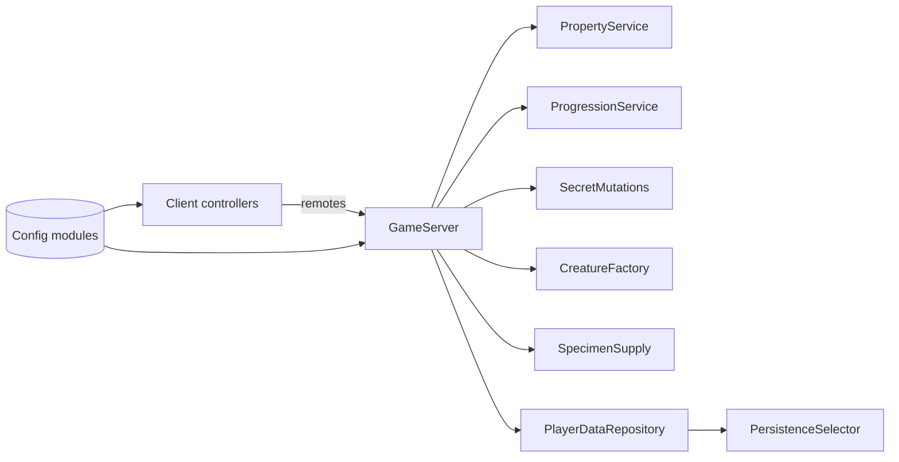

# Architecture

Server-authoritative Roblox game. **Studio is the source of truth**; `~/Claude's Personal Workspace/MutantPetLab/current/source/` is the verified, read-only export (183 scripts, checksum `2048056006`). Code is never copied into this vault. The function-level map is in `Code Graph/` and [[GRAPH_REPORT]].

## Server (`ServerScriptService/MutantPetLab/Services`)
| Module | Role | Related |
|---|---|---|
| `GameServer.server` | Entry point; owns remotes, player lifecycle, breeding, upgrades, research, public state | all |
| `PropertyService` / `PropertySchema` / `PropertyVisuals` / `PlotService` | Plots, pens, crops, feeding, care/wellbeing, incubators, 4-stage expansion, Featured Specimen | [[Economy]], [[Egg Families]] |
| `ProgressionService` | Onboarding guide (18 steps) and assignments (22) | [[Economy]] |
| `CreatureFactory` | Server `Random` trait/variant rolls for every new creature | [[Traits and Variants]] |
| `SecretMutations` + `SecretRecipes` | Server-only secret formulas and evaluation | [[Mutation Recipes]] |
| `SpecimenSupply` | Free specimen cycle with 40-stud range check | [[Economy#Specimen Supply]] |
| `PlayerDataRepository` / `PlayerDataSchema` (v3) / `PersistenceSelector` / `PersistenceConfig` | Load/save, schema, Mock vs Production selection | [[Persistence]] |

## Shared config (`ReplicatedStorage/MutantPetLab/Config`)
SpeciesConfig → [[Species]] · RecipeConfig → [[Mutation Recipes]] · EggFamilyConfig → [[Egg Families]] · TraitConfig → [[Traits and Variants]] · ResearchConfig → [[Research Tree]] · RanchConfig, UpgradeConfig, PropertyExpansionConfig, BuildableConfig, ProgressionConfig, AssignmentConfig, OnboardingConfig → [[Economy]].

## Client controllers
Path: `StarterPlayerScripts/MutantPetLab/Controllers`.
Breeding, CreatureDetail, EggShop, Index, MobileUX, Onboarding, ProgressionHUD, Property, Ranch, Research, Supply, Upgrade. UI work is tracked in [[UI - Figma TODO]].

## Remotes
| Remote | Accepts |
|---|---|
| `GetState` | nothing (read-only) |
| `BreedRequest` | two pet ids |
| `ClaimSpecimen` | nothing; range-checked |
| `BuyUpgrade` | upgrade id |
| `ResearchRequest` | node id |
| `PropertyRequest` | action + payload; own plot only; 0.15 s throttle |
| `ProgressionRequest` | Dismiss / Restore / ViewedCreatures (no rewards) |
| `StateUpdated`, `Toast` | server → client events |

Prices, rewards, rolls, secret conditions, stage and ownership are computed on the server. Low-impact gap: Breed/Upgrade/Research remotes are not location-gated ([[Known Issues]]).

## Tests
`ServerStorage/UnitTest` — 19 case modules, **185/185** at release. Run in a fresh Play server: `require(game.ServerStorage.UnitTest.RunUnitTest)(nil,10)`. History in [[QA - Test History]].

Lessons: [[Server Authority and Anti-Exploit]], [[Testing and Validation]].

%% BEGIN CODE LINKS %%
## Code references (local code graph)

_Generated by `tools/vault_codelinks.py` from the local graphify graph. Links only; edit outside this block._

**Server services**
- [[GameServer.server.luau|GameServer.server]]
- [[PropertyService.luau|PropertyService]]
- [[PropertySchema.luau|PropertySchema]]
- [[PropertyVisuals.luau|PropertyVisuals]]
- [[PlotService.luau|PlotService]]
- [[ProgressionService.luau|ProgressionService]]
- [[CreatureFactory.luau|CreatureFactory]]
- [[SecretMutations.luau|SecretMutations]]
- [[SecretRecipes.luau|SecretRecipes]]
- [[SpecimenSupply.luau|SpecimenSupply]]
- [[PlayerDataRepository.luau|PlayerDataRepository]]
- [[PlayerDataSchema.luau|PlayerDataSchema]]
- [[PersistenceSelector.luau|PersistenceSelector]]
- [[PersistenceConfig.luau|PersistenceConfig]]

**Shared config**
- [[SpeciesConfig.luau|SpeciesConfig]]
- [[RecipeConfig.luau|RecipeConfig]]
- [[EggFamilyConfig.luau|EggFamilyConfig]]
- [[TraitConfig.luau|TraitConfig]]
- [[ResearchConfig.luau|ResearchConfig]]
- [[RanchConfig.luau|RanchConfig]]
- [[UpgradeConfig.luau|UpgradeConfig]]
- [[PropertyExpansionConfig.luau|PropertyExpansionConfig]]
- [[BuildableConfig.luau|BuildableConfig]]
- [[ProgressionConfig.luau|ProgressionConfig]]
- [[AssignmentConfig.luau|AssignmentConfig]]
- [[OnboardingConfig.luau|OnboardingConfig]]

**Client controllers**
- [[BreedingController.client.luau|BreedingController.client]]
- [[CreatureDetailController.client.luau|CreatureDetailController.client]]
- [[EggShopController.client.luau|EggShopController.client]]
- [[IndexController.client.luau|IndexController.client]]
- [[MobileUXController.client.luau|MobileUXController.client]]
- [[OnboardingController.client.luau|OnboardingController.client]]
- [[ProgressionHUDController.client.luau|ProgressionHUDController.client]]
- [[PropertyController.client.luau|PropertyController.client]]
- [[RanchController.client.luau|RanchController.client]]
- [[ResearchController.client.luau|ResearchController.client]]
- [[SupplyController.client.luau|SupplyController.client]]
- [[UpgradeController.client.luau|UpgradeController.client]]

**Test harness**
- [[RunUnitTest.luau|RunUnitTest]]
- [[UnitTestRunner.server.luau|UnitTestRunner.server]]
- [[ArchitectureNotes.luau|ArchitectureNotes]] — stale comment module: still says persistence is disabled (see [[Persistence]])
%% END CODE LINKS %%
