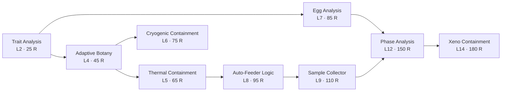

%% BEGIN GENERATED %%
# Research Tree

9 nodes bought with Research at the campus Research Terminal. Levels and prerequisites are validated server-side; the graph is acyclic (tests).

## Trait Analysis
Level 2 · 25 Research

Reveals trait and variant information on individual specimens.

## Adaptive Botany
Level 4 · 45 Research · requires [[Research Tree#Trait Analysis|Trait Analysis]]

Unlocks advanced crop cultures (Level 4+ crops), Botanical and Humid habitats, and Botanical Culture Eggs.

## Thermal Containment
Level 5 · 65 Research · requires [[Research Tree#Adaptive Botany|Adaptive Botany]]

Unlocks the Thermal habitat and Thermal Core Eggs.

## Cryogenic Containment
Level 6 · 75 Research · requires [[Research Tree#Adaptive Botany|Adaptive Botany]]

Unlocks the Cryogenic habitat and Cryogenic Capsule Eggs.

## Egg Analysis
Level 7 · 85 Research · requires [[Research Tree#Trait Analysis|Trait Analysis]]

Unlocks Conductive Coil Eggs and the Conductive habitat.

## Auto-Feeder Logic
Level 8 · 95 Research · requires [[Research Tree#Thermal Containment|Thermal Containment]]

Unlocks the pen Auto-Feeder: hungry creatures eat from your stored crops.

## Sample Collector
Level 9 · 110 Research · requires [[Research Tree#Auto-Feeder Logic|Auto-Feeder Logic]]

Unlocks the pen Sample Collector for stored, one-tap sample pickup.

## Phase Analysis
Level 12 · 150 Research · requires [[Research Tree#Egg Analysis|Egg Analysis]], [[Research Tree#Sample Collector|Sample Collector]]

Unlocks Unstable Mutagen Eggs and stabilizes phase-shift mutations.

## Xeno Containment
Level 14 · 180 Research · requires [[Research Tree#Phase Analysis|Phase Analysis]]

Unlocks Experimental and Unstable habitats for the lab's strangest lineages.

Related: [[Egg Families]], [[Economy]], [[Architecture]]
%% END GENERATED %%

## Notes

%% BEGIN CODE LINKS %%
## Code references (local code graph)

_Generated by `tools/vault_codelinks.py` from the local graphify graph. Links only; edit outside this block._

**Modules**
- [[ResearchConfig.luau|ResearchConfig]] — nodes, levels, costs, prerequisites
- [[GameServer.server.luau|GameServer.server]] — ResearchRequest handler (anonymous function, not a graph node)
- [[ResearchController.client.luau|ResearchController.client]] — Research Terminal UI

> [!note] `getMissingPrerequisite()` in GameServer is deliberately not linked: it checks **upgrade** prerequisites, not research.
%% END CODE LINKS %%
